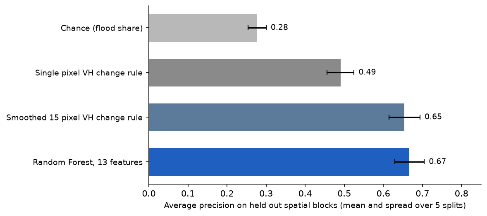
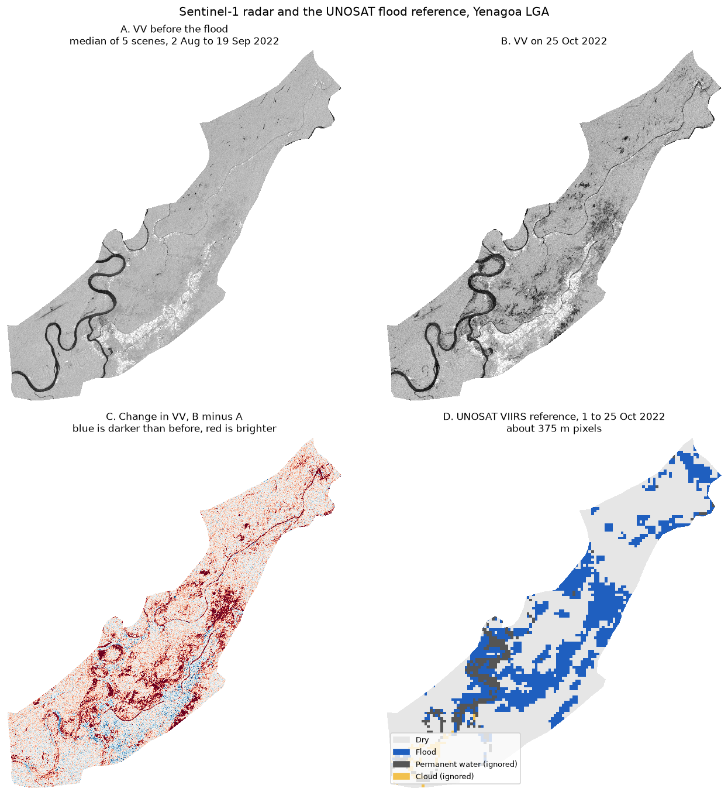
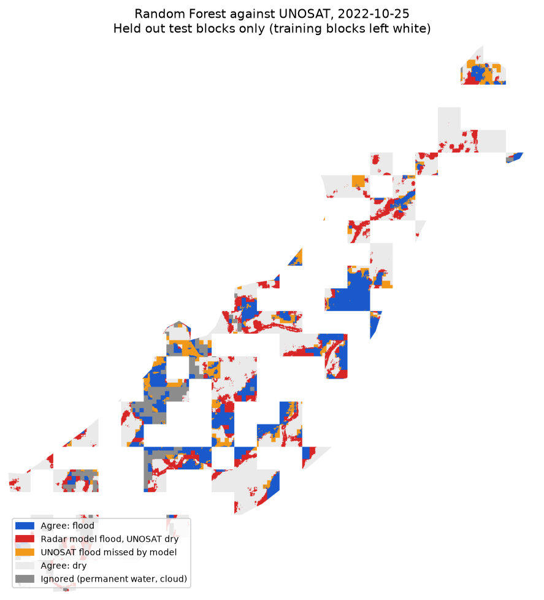

# Mapping the October 2022 Yenagoa flood with Sentinel-1 radar

In October 2022 the Niger Delta flooded, and for much of the event cloud blocked optical satellites. Radar sees through cloud. This project asks a narrow question: over Yenagoa Local Government Area in Bayelsa State, how well does Sentinel-1 radar agree with the UNOSAT satellite flood extent, and is a machine learning model worth more than a simple threshold?

The short answer: radar agrees moderately well, averaging the radar change over about 375 m does most of the work, and a Random Forest adds only a small extra gain. The scores measure agreement with UNOSAT, which is itself a coarse optical product. They are not accuracy against ground truth.

## Findings at a glance

Average precision on spatial blocks held out from training and tuning. Spread is the standard deviation over five random block splits. Chance equals the share of flooded pixels in the test blocks.

| Method | Average precision |
|---|---|
| Chance | 0.28 ± 0.02 |
| Single pixel VH change rule | 0.49 ± 0.03 |
| Same rule on change averaged over 15 pixels (about 375 m), no machine learning | 0.65 ± 0.04 |
| Random Forest, 13 features | 0.67 ± 0.04 |

1. Averaging the radar change over about 375 m lifts average precision from 0.49 to 0.65. This is noise reduction, and it also matches the size of one UNOSAT pixel.
2. The Random Forest beats the averaged rule in all five splits, but only by 0.007 to 0.020 (mean 0.013). That is much smaller than the 0.04 spread between splits.
3. The model carries over to a date it never saw. Trained on 25 October only, it scored average precision 0.67 on 13 October against a separate UNOSAT window, where chance is 0.23.
4. At UNOSAT's own 375 m scale the ROC AUC is 0.86.

## Study area and data

| Item | Detail |
|---|---|
| Area | Yenagoa LGA, Bayelsa State, Nigeria, 706 km² (FAO GAUL 2025) |
| Radar | Sentinel-1 GRD, IW mode, VV and VH, via Google Earth Engine (`COPERNICUS/S1_GRD`) |
| Orbit | Descending relative orbit 22 only, so the viewing angle never changes between dates |
| Before flood | Median of five scenes: 2 Aug, 14 Aug, 26 Aug, 7 Sep, 19 Sep 2022 |
| During flood | 13 Oct and 25 Oct 2022 |
| Reference | UNOSAT VIIRS flood extent, event FL20221019NGA, from the Humanitarian Data Exchange |

All Sentinel-1 scenes over Yenagoa between July and December 2022 come from Sentinel-1A, so the revisit on one orbit is 12 days. Descending orbit 22 and ascending orbit 103 both cover the whole LGA. Orbit 22 was used because its 12 day sequence has no gaps and it has scenes on 1, 13 and 25 October, inside the UNOSAT window.

UNOSAT windows over Yenagoa, clipped to the LGA boundary:

| Window | Flood | Cloud | Use |
|---|---|---|---|
| 1 to 30 Sep | 7.4 km² (1.1%) | 1.1% | Confirms the before period has almost no flood |
| 8 to 12 Oct | 106.9 km² (15.1%) | 6.8% | Not used |
| 13 to 17 Oct | 137.3 km² (19.4%) | 17.7% | Reference for the 13 Oct transfer test |
| 19 to 23 Oct | 0.6 km² | 95.1% | Unusable, almost all cloud |
| 1 to 25 Oct | 198.6 km² (28.1%) | 1.2% | Main reference, a maximum extent over 25 days |

## Method

1. **Radar preparation.** Earth Engine already calibrates and terrain corrects Sentinel-1 GRD scenes to dB. A focal median of 30 m radius reduces speckle. Rasters were exported at 25 m (the native pixel is 10 m) because of the Earth Engine download size limit, as int16 values of dB × 100.
2. **Labels.** UNOSAT polygons were rasterised onto the radar grid. Pixels are flood, dry, permanent water or cloud. Permanent water and cloud pixels are ignored when scoring, because they say nothing about the flood. Only pixels inside the LGA boundary count.
3. **Spatial validation.** The area was cut into blocks of 80 × 80 pixels (about 2 km). 60% of blocks were used for training and tuning and 40% were held out for testing. Neighbouring pixels look alike, so a random pixel split would flatter every method. The split was repeated with five seeds (42, 1, 2, 3, 4).
4. **Threshold baselines.** Rules on VV during the flood, change in VV, and change in VH, with the threshold tuned on the training blocks by F1. Two fixed rules from common practice are also shown.
5. **Smoothed baseline.** The same change rule applied to the change averaged over 15 pixels, with no machine learning. This tests whether a model is needed at all.
6. **Random Forest.** 13 features: VV and VH before and during the flood, both changes, VV minus VH, 5 and 15 pixel averages of the changes, a 5 pixel average and local standard deviation of VV, and no terrain or land cover. Class weights are balanced and the probability cutoff is fixed at 0.5 in advance.
7. **Scores.** Precision, recall, F1 and IoU at a cutoff, and two scores that need no cutoff: average precision and ROC AUC.

## Results

### One split (seed 42), 25 October, pixel level

| Method | Precision | Recall | F1 |
|---|---|---|---|
| VV below −18 dB (fixed) | 0.650 | 0.062 | 0.113 |
| VV change below −3 dB (fixed) | 0.607 | 0.303 | 0.404 |
| VV below −8 dB (tuned) | 0.427 | 0.648 | 0.515 |
| VV change below −1 dB (tuned) | 0.400 | 0.607 | 0.482 |
| VH change below −1 dB (tuned) | 0.427 | 0.585 | 0.494 |
| Random Forest | 0.559 | 0.699 | 0.621 |

The Random Forest IoU is 0.451. The fixed open water rule of −18 dB finds only 6% of the UNOSAT flood, so most of the flooded ground is darker than before without being dark enough to look like open water.

### Five splits

| Split seed | RF average precision | RF ROC AUC | RF F1 | Single pixel VH rule AP | Averaged 15 pixel VH rule AP |
|---|---|---|---|---|---|
| 42 | 0.695 | 0.822 | 0.622 | 0.516 | 0.688 |
| 1 | 0.602 | 0.797 | 0.567 | 0.432 | 0.588 |
| 2 | 0.678 | 0.827 | 0.636 | 0.499 | 0.668 |
| 3 | 0.689 | 0.813 | 0.634 | 0.514 | 0.677 |
| 4 | 0.670 | 0.818 | 0.630 | 0.492 | 0.650 |
| Mean ± spread | 0.667 ± 0.038 | 0.816 ± 0.011 | 0.618 ± 0.029 | 0.490 ± 0.034 | 0.654 ± 0.039 |

The five splits come from one area and their blocks overlap, so the spread is a rough guide and not a confidence interval. Split 1 is harder for every method, which shows that the choice of test area matters more than the choice of method.

The two most important Random Forest features are the 15 pixel averages of VV change (0.30) and VH change (0.26). Feature importance from a Random Forest is only a rough guide.

### At UNOSAT's own scale (about 375 m cells)

One UNOSAT pixel covers roughly 15 × 15 of ours. Pixels were grouped into 375 m cells, using the seed 42 held out blocks only. A cell counts as UNOSAT flood if at least half of it is flooded. There are 1,487 cells, of which 456 (30.7%) are flood.

| Score | Random Forest | Averaged VH change rule |
|---|---|---|
| Average precision | 0.768 | 0.720 |
| ROC AUC | 0.858 | 0.816 |
| Correlation with UNOSAT flood fraction | 0.621 | 0.554 |

Random Forest cutoff sensitivity at cell level (the cutoff was not tuned, this is shown for information):

| Cutoff | Precision | Recall | F1 |
|---|---|---|---|
| 0.3 | 0.465 | 0.925 | 0.619 |
| 0.4 | 0.539 | 0.825 | 0.652 |
| 0.5 | 0.631 | 0.719 | 0.672 |
| 0.6 | 0.728 | 0.623 | 0.671 |
| 0.7 | 0.820 | 0.489 | 0.613 |

### Transfer to a new date

The Random Forest was trained on 25 October radar and labels only, then scored on the 13 October radar against the separate 13 to 17 October UNOSAT window, on the same held out blocks. Cloud covered pixels in that window are ignored (17.7% of the LGA).

| | Random Forest | Single pixel VH rule |
|---|---|---|
| Average precision (chance 0.234) | 0.667 | 0.467 |
| ROC AUC | 0.839 | 0.697 |
| Precision, recall, F1 at cutoff 0.5 | 0.512, 0.748, 0.608 | |
| 375 m cell average precision, ROC AUC | 0.742, 0.878 | 0.694, 0.843 |

The 25 October score on the same blocks was average precision 0.694 and ROC AUC 0.821, so performance is similar on the new date.

Figure 2 colours: blue is flood in both, red is flood in the model only, orange is UNOSAT flood the model missed, light grey is dry in both, dark grey is ignored. Only held out blocks are shown.

## What this does and does not show

1. **The reference is coarse.** UNOSAT VIIRS pixels are about 375 m, and the 1 to 25 October layer is a maximum extent over 25 days, so a single radar date can legitimately show less. The scores measure agreement with UNOSAT. They do not measure accuracy against the ground.
2. **Radar errors and reference errors are mixed together.** Radar is known to struggle with flooding under vegetation, but this study cannot separate that from the coarseness of the reference, so I do not claim it explains the missed flood.
3. **Most of the gain is averaging.** The averaged rule is almost as good as the Random Forest, and the strongest features are averages at the scale of one UNOSAT pixel. The model should not be described as having learned flooding.
4. **Small scope.** One LGA, two dates, one orbit, one reference product, no field data.
5. **Cutoffs.** The Random Forest cutoff of 0.5 was fixed in advance. The cell level cutoff table is a sensitivity check, not a tuned result.
6. **Resolution.** Radar was exported at 25 m, not the native 10 m.
7. **Ignored pixels.** Permanent water and cloud come from the same 375 m UNOSAT product, so ignoring them also removes some land beside rivers from the scoring.

## A pipeline check worth knowing about

An early version of the scripts scored the whole bounding box of the raster, which is about three times larger than the LGA, and labelled the 25 October flood only inside the LGA boundary. That produced misleading scores. The fix is an exact LGA mask on the radar grid (`scripts/06_make_inside_mask.py`) and every number in this README comes from a full rerun after the fix. The printed output of that run is in `logs/`.

## Repository layout

| Path | Contents |
|---|---|
| `scripts/` | Numbered scripts in the order they were run |
| `logs/` | Printed output of the final run: `01_baseline.txt` (script 07), `02_rf.txt` (08), `03_scale.txt` (09), `04_transfer.txt` (10), `05_seeds.txt` (11) |
| `results/seed_results.csv` | Scores for each of the five splits |
| `figures/` | Figures used in this README |

Rasters and intermediate arrays are not stored in the repository. They are rebuilt by the scripts.

## Reproducing the work

Python 3.11 or newer and a Google Earth Engine account with a Cloud project. Install the packages in `requirements.txt`, run `earthengine authenticate`, and replace the project ID in the scripts with your own. Run the scripts from the repository root, in number order. Scripts 04, 07 and 10 expect the UNOSAT shapefiles for event FL20221019NGA under `~/nigeria-flood-access/data/flood/`, including `yenagoa_clipped/yenagoa_flood_final.shp`, which is the 1 to 25 October extent clipped to Yenagoa, produced in my companion repository [yenagoa-flood-healthcare-access](https://github.com/Nobleteesage/yenagoa-flood-healthcare-access).

## Credits

Contains modified Copernicus Sentinel data (2022). UNOSAT VIIRS flood extent for event FL20221019NGA, obtained from the Humanitarian Data Exchange. FAO GAUL 2025 administrative boundaries, via Google Earth Engine.

## Author

Goriola-Obafemi Babatunde Sukanmi. See [AUTHOR.md](AUTHOR.md).
